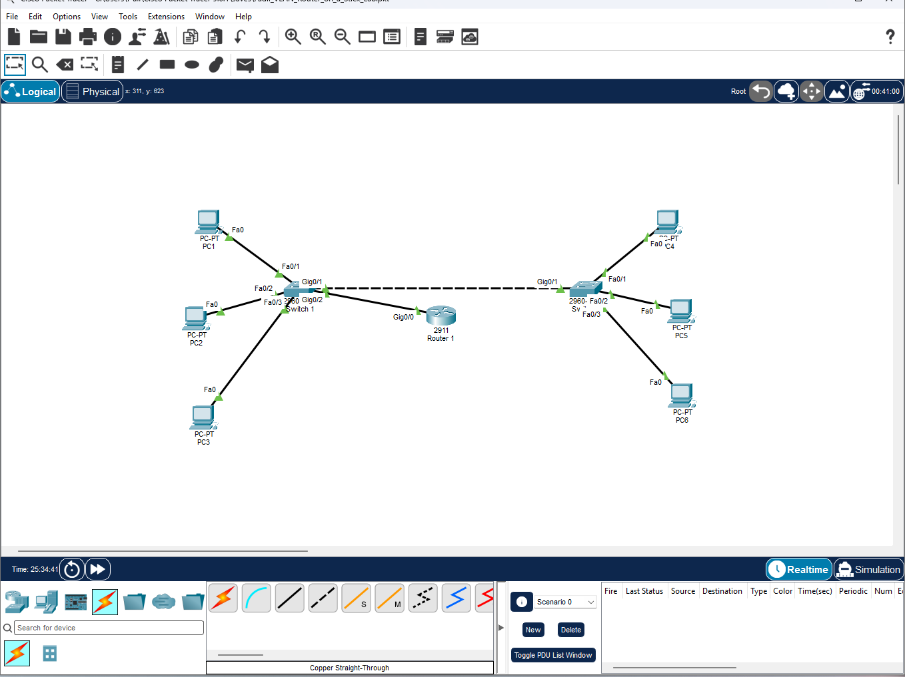
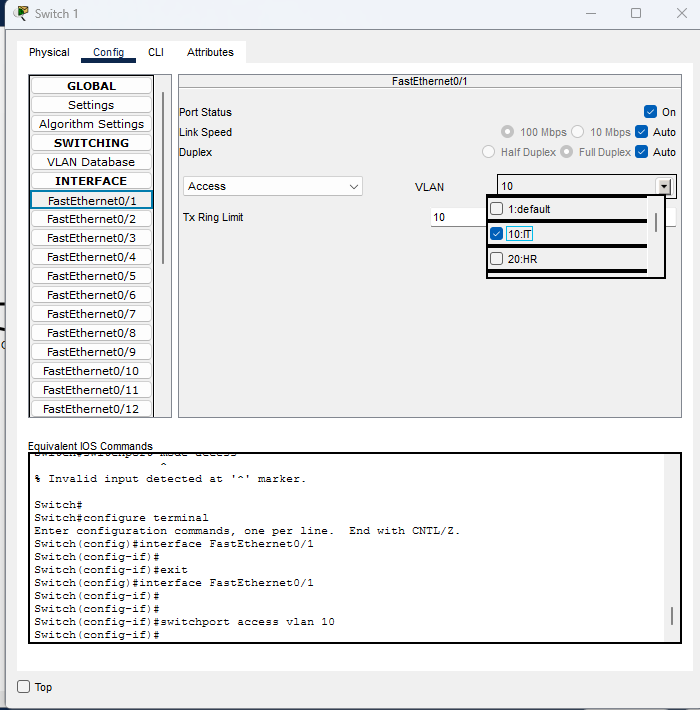
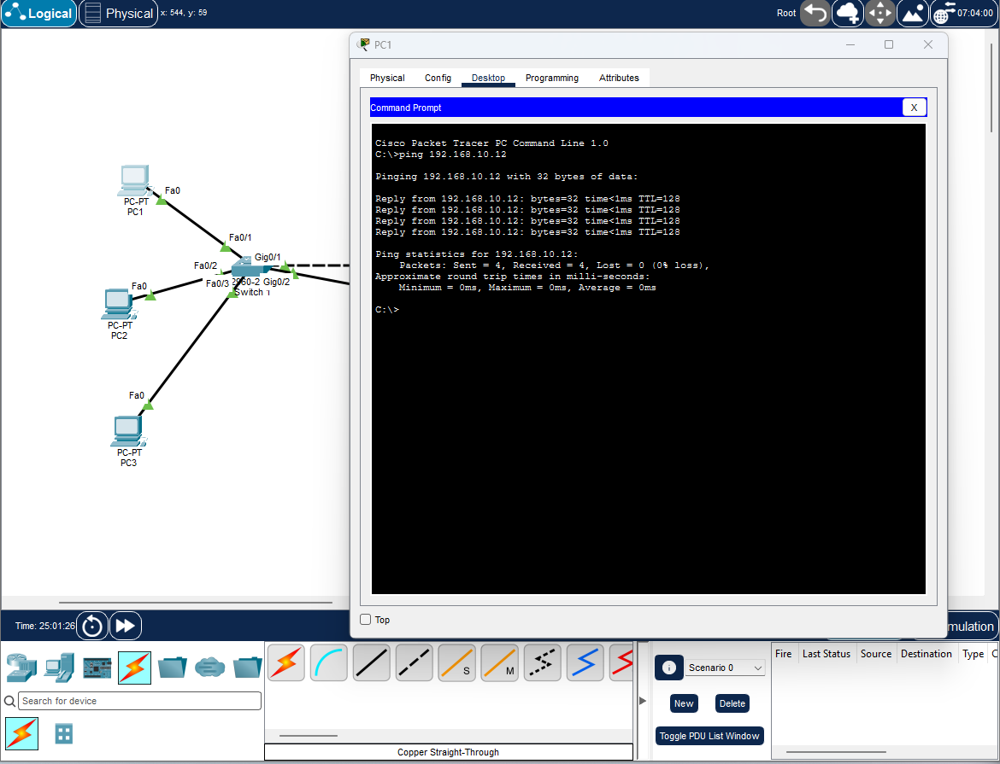

# Cisco VLAN & Inter-VLAN Routing Lab

I designed and configured a multi-VLAN network in Cisco Packet Tracer to demonstrate departmental segmentation, 802.1Q trunking, and router-on-a-stick inter-VLAN routing. The completed topology connects six endpoints across two switches and provides verified communication within and between three VLANs.



## Project overview

| Component | Implementation |
|---|---|
| Environment | Cisco Packet Tracer simulation |
| Switching | Two Cisco Catalyst 2960 switches |
| Routing | One Cisco 2911 router using router-on-a-stick |
| Endpoints | Six PCs distributed across both switches |
| Segmentation | VLAN 10 (IT), VLAN 20 (HR), VLAN 30 (Sales) |
| Trunking | 802.1Q switch-to-switch and switch-to-router trunks |
| Validation | Cisco IOS show commands and end-to-end ICMP testing |

## Network design

I separated IT, HR, and Sales into distinct Layer 2 broadcast domains. Each PC connects to an access port assigned to its department's VLAN. The trunk between the switches transports all three VLANs, while the router-facing trunk carries tagged traffic to the router subinterfaces that act as the VLAN default gateways.

### Physical and logical connections

| Link | Interface assignment | Purpose |
|---|---|---|
| Switch1 to Switch2 | Switch1 G0/1 ↔ Switch2 G0/1 | 802.1Q inter-switch trunk |
| Switch1 to Router1 | Switch1 G0/2 ↔ Router1 G0/0 | 802.1Q router-on-a-stick trunk |
| PC1 / PC2 / PC3 | Switch1 Fa0/1 / Fa0/2 / Fa0/3 | VLAN 10 / 20 / 30 access ports |
| PC4 / PC5 / PC6 | Switch2 Fa0/1 / Fa0/2 / Fa0/3 | VLAN 10 / 20 / 30 access ports |

### VLAN and access-port assignments

| VLAN | Department | Switch1 access port | Switch2 access port |
|---:|---|---|---|
| 10 | IT | Fa0/1 | Fa0/1 |
| 20 | HR | Fa0/2 | Fa0/2 |
| 30 | Sales | Fa0/3 | Fa0/3 |

### IPv4 addressing plan

| Device | Department | VLAN | IPv4 address | Default gateway |
|---|---|---:|---|---|
| PC1 | IT | 10 | 192.168.10.11/24 | 192.168.10.1 |
| PC4 | IT | 10 | 192.168.10.12/24 | 192.168.10.1 |
| PC2 | HR | 20 | 192.168.20.11/24 | 192.168.20.1 |
| PC5 | HR | 20 | 192.168.20.12/24 | 192.168.20.1 |
| PC3 | Sales | 30 | 192.168.30.11/24 | 192.168.30.1 |
| PC6 | Sales | 30 | 192.168.30.12/24 | 192.168.30.1 |

| Router subinterface | VLAN | Gateway address |
|---|---:|---|
| G0/0.10 | 10 | 192.168.10.1/24 |
| G0/0.20 | 20 | 192.168.20.1/24 |
| G0/0.30 | 30 | 192.168.30.1/24 |

## Implementation

### VLAN access ports

I created VLANs 10, 20, and 30 on both switches and assigned each PC-facing interface as a static access port. An access port carries traffic for one VLAN and sends ordinary untagged Ethernet frames to the connected endpoint.



### 802.1Q trunking

I configured G0/1 on both switches as an 802.1Q trunk so that one physical link could transport traffic for all three VLANs. I also configured Switch1 G0/2 as a trunk to Router1 G0/0. Frames crossing these trunks are tagged with their VLAN ID, allowing the receiving device to preserve VLAN separation.

```text
Switch1 G0/1  <--- 802.1Q trunk --->  Switch2 G0/1
Switch1 G0/2  <--- 802.1Q trunk --->  Router1 G0/0
```

### Router-on-a-stick

I configured three logical subinterfaces on the router's physical G0/0 interface. Each subinterface uses 802.1Q encapsulation for one VLAN and provides that subnet's default gateway.

```cisco
interface GigabitEthernet0/0.10
 encapsulation dot1Q 10
 ip address 192.168.10.1 255.255.255.0

interface GigabitEthernet0/0.20
 encapsulation dot1Q 20
 ip address 192.168.20.1 255.255.255.0

interface GigabitEthernet0/0.30
 encapsulation dot1Q 30
 ip address 192.168.30.1 255.255.255.0
```

When a VLAN 10 host sends traffic to a VLAN 30 host, it forwards the packet to `192.168.10.1`. The frame travels over the router trunk with an 802.1Q VLAN 10 tag. Router1 receives it on G0/0.10, routes the packet to the VLAN 30 network, and sends it through G0/0.30. The switches then deliver the frame to the destination's VLAN 30 access port.

The complete confirmed configuration excerpts are available in [`configs/`](configs/).

## Verification

I verified the deployment at Layer 2 and Layer 3 using Cisco IOS commands and ICMP tests.

| Test | Command or traffic | Confirmed result |
|---|---|---|
| VLAN membership | `show vlan brief` | VLANs 10, 20, and 30 active with the intended access ports |
| Trunk state | `show interfaces trunk` | Required trunks operational using 802.1Q |
| Trunk forwarding | `show interfaces trunk` | VLANs 10, 20, and 30 active and forwarding |
| Router interfaces | `show ip interface brief` | G0/0.10, G0/0.20, and G0/0.30 up/up |
| Same-VLAN test | PC1 → 192.168.10.12 | Four replies, 0% packet loss |
| Inter-VLAN test | PC1 → 192.168.20.11 | Successful replies through Router1 |
| Cross-switch inter-VLAN test | PC1 → 192.168.30.12 | Successful replies through Router1 and both switches |



The inter-VLAN replies returned with TTL 127, consistent with the packets crossing one routed hop. The first request in two tests timed out while Packet Tracer resolved the required ARP information; subsequent requests succeeded.

Exact captured command output and ping results are documented in [`docs/verification-results.md`](docs/verification-results.md).

## Troubleshooting and resolution

### Correcting access-port VLAN assignments

During configuration validation, I found that two access ports had temporarily been assigned to the wrong VLANs. I used `show vlan brief` to compare the active port membership against the design table, corrected Fa0/1 to VLAN 10 and Fa0/3 to VLAN 30, and reran the command to confirm the intended assignments.

### Completing end-to-end trunk forwarding

An initial trunk check showed the local interface in trunking mode without VLANs in the spanning-tree forwarding list. I completed the matching trunk configuration on the remote switch and verified that VLANs 10, 20, and 30 appeared as active and forwarding across the link.

## Open and test the lab

1. Install Cisco Packet Tracer.
2. Download and open [`packet-tracer/cisco-vlan-intervlan-routing-lab.pkt`](packet-tracer/cisco-vlan-intervlan-routing-lab.pkt).
3. Allow the simulated links to reach an operational state.
4. Open PC1, select **Desktop → Command Prompt**, and test:

```text
ping 192.168.10.12
ping 192.168.20.11
ping 192.168.30.12
```

5. Use the device CLIs to inspect the VLANs, trunks, and router interfaces:

```cisco
show vlan brief
show interfaces trunk
show ip interface brief
```

## Repository contents

```text
.
├── README.md
├── configs/
│   ├── router-relevant-config.txt
│   ├── switch1-relevant-config.txt
│   └── switch2-relevant-config.txt
├── docs/
│   └── verification-results.md
├── images/
│   ├── network-topology.png
│   ├── same-vlan-connectivity.png
│   └── vlan-access-port.png
└── packet-tracer/
    └── cisco-vlan-intervlan-routing-lab.pkt
```

## Skills demonstrated

- VLAN creation and departmental network segmentation
- Static access-port assignment
- IEEE 802.1Q trunk configuration and verification
- Router-on-a-stick and router subinterfaces
- IPv4 subnet and default-gateway planning
- Cisco IOS configuration and operational verification
- Layer 2 and Layer 3 connectivity testing
- Structured network troubleshooting and documentation
